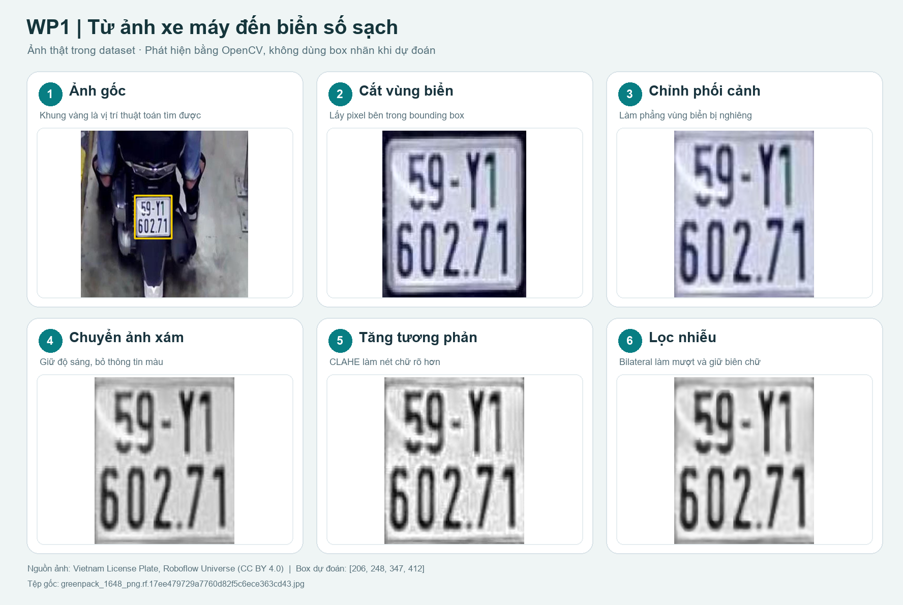
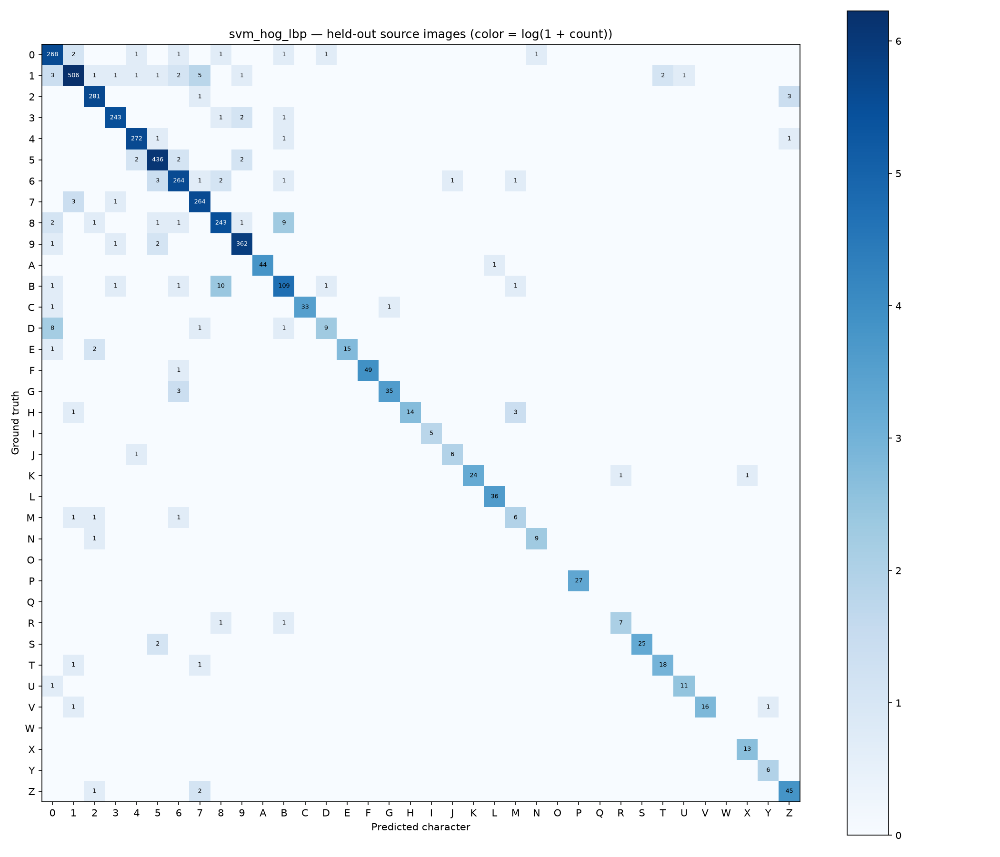
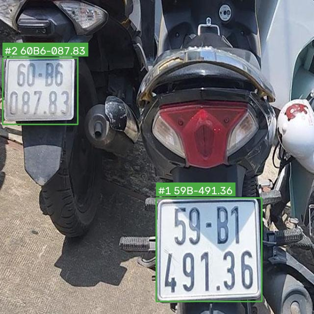
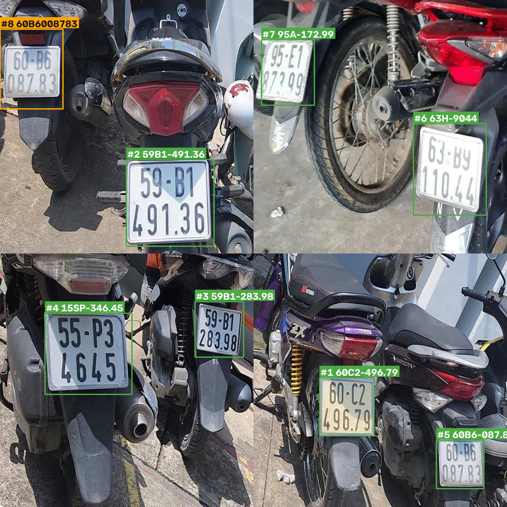

# BÁO CÁO ĐỒ ÁN MÔN HỌC

## NHẬN DIỆN BIỂN SỐ XE VIỆT NAM BẰNG THỊ GIÁC MÁY TÍNH TRUYỀN THỐNG

<br>

| | |
|---|---|
| **Trường** | …………………………………………… |
| **Khoa/Bộ môn** | …………………………………………… |
| **Môn học** | Xử lý ảnh số / Thị giác máy tính |
| **Giảng viên hướng dẫn** | …………………………………………… |
| **Nhóm thực hiện** | Nhóm … — Lớp … |
| **Thành viên** | 1. …………………… — MSSV: …………………… <br> 2. …………………… — MSSV: …………………… <br> 3. …………………… — MSSV: …………………… <br> 4. …………………… — MSSV: …………………… |
| **Năm học** | 2025 – 2026 |

<br>

> **Ghi chú về tài liệu:** Đây là bản Markdown của báo cáo đồ án. Số trang trong
> mục lục tương ứng với bản PDF/Word khi xuất; khi chuyển sang Word, giữ
> `Heading 1` cho tên chương và `Heading 2/3` cho mục con để tự động sinh mục
> lục. Các ô `…………` dành cho thông tin hành chính cần điền.

---

## MỤC LỤC

| Nội dung | Trang |
|---|---:|
| TÓM TẮT | 4 |
| BẢNG PHÂN CÔNG CÔNG VIỆC TRONG NHÓM | 5 |
| CHƯƠNG I. GIỚI THIỆU | 6 |
| CHƯƠNG II. CƠ SỞ LÝ THUYẾT | 7 |
| CHƯƠNG III. PHÂN TÍCH VÀ THIẾT KẾ HỆ THỐNG | 8 |
| CHƯƠNG IV. XÂY DỰNG VÀ TRIỂN KHAI | 9 |
| CHƯƠNG V. ĐÁNH GIÁ VÀ KẾT QUẢ | 10 |
| CHƯƠNG VI. KẾT LUẬN VÀ HƯỚNG PHÁT TRIỂN | 11 |
| TÀI LIỆU THAM KHẢO | 12 |
| PHỤ LỤC (NẾU CÓ) | 13 |

---

<div style="page-break-before: always;"></div>

## TÓM TẮT

Đồ án xây dựng một hệ thống nhận diện biển số xe Việt Nam chạy cục bộ theo
hướng thị giác máy tính truyền thống, không dùng mạng học sâu huấn luyện
đầu-cuối. Hệ thống được chia thành bốn giai đoạn độc lập, gọi là WP1–WP4:

1. **WP1 — Phát hiện biển:** sinh vùng ứng viên từ cạnh, hình thái học, màu
   HSV và contour, xếp hạng bằng đặc trưng hình học kết hợp HOG + SVM.
2. **WP2 — Tách ký tự:** nhị phân hóa đa ngưỡng, tách dòng bằng projection,
   lọc và sửa ký tự dính/gãy, chuẩn hóa về 32×32.
3. **WP3 — Nhận diện ký tự:** HOG 324 chiều kết hợp LBP 10 chiều, phân loại
   bằng SVM kernel RBF.
4. **WP4 — Hậu xử lý và lưu trữ:** regex ba mẫu biển, sửa tám cặp ký tự nhầm
   theo vị trí, tra mã đăng ký, voting video, lưu SQLite và hiển thị web.

Hệ thống có giao diện HTML/JavaScript, API FastAPI, upload ảnh/video, webcam,
lịch sử, thống kê, chỉnh sửa kết quả và chế độ đọc nhiều biển trong một ảnh.
Toàn bộ pipeline chạy trên CPU, không phụ thuộc dịch vụ đám mây.

**Kết quả đo được (không gộp các phạm vi khác nhau):**

| Phạm vi | Kết quả chính |
|---|---|
| WP1 độc lập, COCO test 169 ảnh / 172 box | TP/FP/FN = 124/17/48; Precision 0,8794; Recall 0,7209; F1 0,7923 |
| Bộ chọn vùng của ứng dụng (có WP2–WP4 hỗ trợ) | 138/23/34; Precision 0,8571; Recall 0,8023; F1 0,8288 |
| WP2 tách ký tự, 478 crop test | Recall 92,57%; Precision 97,15%; đúng số dòng 94,98% |
| WP3 phân loại ký tự, 3.834 ký tự test | Accuracy 96,53%; macro F1 0,8484 |
| Chuỗi OCR trên 478 crop test | Đúng nguyên chuỗi 69,46%; CER 9,36%; WER 30,54% |
| Nhiều biển, valid prominent (box ≥1% diện tích) | Precision 0,9333; Recall 0,5957; F1 0,7273 |

**Kết luận:** hệ thống đã hoàn thành đủ bốn giai đoạn và chạy được end-to-end
ở mức chức năng. Tuy nhiên, mục tiêu accuracy chưa đạt đầy đủ. Nguyên nhân
chính đã được định lượng: **44/48 FN của WP1 không có bất kỳ proposal đúng
nào trong top 10**, tức nút thắt nằm ở khâu sinh ứng viên chứ không phải xếp
hạng. Với OCR, accuracy từng ký tự 96,53% tạo trần lý thuyết khoảng
`0,9653^9 ≈ 72,8%` cho biển 9 ký tự, nên kết quả 69,46% nằm sát trần của
kiến trúc hiện tại. Đồ án cũng chỉ rõ giới hạn quan trọng: chưa có tập ảnh
giao thông gốc kèm chuỗi biển thật độc lập, nên **chưa thể kết luận accuracy
toàn luồng đạt 70%**.

---

<div style="page-break-before: always;"></div>

## BẢNG PHÂN CÔNG CÔNG VIỆC TRONG NHÓM

| Thành viên | MSSV | Giai đoạn phụ trách | Công việc chính | Sản phẩm bàn giao | Tỉ lệ |
|---|---|---|---:|---|---:|
| **Thành viên A** | ………… | WP1 — Phát hiện biển | Khảo sát dữ liệu COCO; cài đặt sinh ứng viên; scoring heuristic; huấn luyện và tích hợp HOG+SVM re-ranker; đo Precision/Recall/F1; chẩn đoán lỗi top-10 | `src/detection.py`, `src/hog.py`, `src/reclassifier.py`, `models/wp1_svm.pkl`, `reports/wp1_evaluation.md` | 25% |
| **Thành viên B** | ………… | WP2 — Tách ký tự | Cài đặt Otsu/adaptive; tách dòng bằng projection; lọc và sửa ký tự dính/gãy; chuẩn hóa 32×32; chọn cấu hình trên valid | `src/binarization.py`, `src/line_separation.py`, `src/character_segmentation.py`, `src/normalize_character.py`, `reports/wp2_evaluation.md` | 25% |
| **Thành viên C** | ………… | WP3 — Nhận diện ký tự | Chuẩn bị dữ liệu 36 lớp; cài đặt HOG/LBP; huấn luyện 5 model; so sánh, ablation, confusion matrix, robustness; tích hợp model artifact | `src/feature_hog.py`, `src/feature_lbp.py`, `src/character_classifier.py`, `models/svm_hog_lbp.pkl`, `reports/wp3_comparison.md` | 25% |
| **Thành viên D** | ………… | WP4 — Hậu xử lý, API, web, demo | Regex và sửa nhầm; tra mã đăng ký; voting video; SQLite CRUD; FastAPI; giao diện web; multi-plate; đóng gói demo | `src/pipeline_wp4.py`, `src/database.py`, `api/main.py`, `web/`, `src/multi_plate.py`, `demo/` | 25% |

**Công việc chung của cả nhóm:**

| Công việc | Người chủ trì | Người phối hợp |
|---|---|---|
| Chốt yêu cầu, tiêu chí nghiệm thu, phân chia giai đoạn | Cả nhóm | — |
| Thiết kế giao diện WP1–WP2 và WP2–WP3 | A, B | C |
| Chạy đánh giá cuối, kiểm tra chéo số liệu | A, C | B, D |
| Viết báo cáo, chuẩn bị slide và kịch bản demo | D | Cả nhóm |
| Tập duyệt và trả lời phản biện | Cả nhóm | — |

> **Ghi chú:** bảng trên dùng chữ cái thay cho họ tên để tránh nhầm khi sao
> chép. Khi nộp, điền họ tên và MSSV thật; tỉ lệ có thể điều chỉnh theo nhật
> ký đóng góp thực tế, miễn tổng bằng 100%.

---

<div style="page-break-before: always;"></div>

# CHƯƠNG I. GIỚI THIỆU

## 1.1. Đặt vấn đề

Nhận diện biển số xe tự động (Automatic License Plate Recognition — ALPR) là
một bài toán kinh điển của thị giác máy tính, có ứng dụng trực tiếp trong quản
lý bãi xe, giám sát giao thông, kiểm soát ra vào và số hóa dữ liệu phương
tiện. Bài toán gồm hai bài toán con nối tiếp: **phát hiện vị trí biển** trong
ảnh và **đọc nội dung chuỗi** trên biển.

Với biển số Việt Nam, bài toán có thêm các khó khăn đặc thù:

- Biển một dòng và hai dòng cùng tồn tại; biển xe máy thường hai dòng, kích
  thước nhỏ, chữ xếp sát.
- Ký tự in theo nhiều phông, có nét đứt, nét dính, viền biển dính thân xe.
- Ảnh chụp thực tế bị nghiêng, lóa, mờ do chuyển động, độ phân giải thấp.
- Chuỗi có cấu trúc: hai số đầu là mã đăng ký, tiếp theo là chữ cái seri và
  phần số; dấu `-` và `.` chỉ để định dạng, không phải ký tự trên biển.

Có hai hướng tiếp cận phổ biến. Hướng thứ nhất dùng học sâu đầu-cuối
(detector + recognizer), cho độ chính xác cao nhưng cần nhiều dữ liệu gán
nhãn, khó giải thích và phụ thuộc tài nguyên tính toán. Hướng thứ hai dùng
chuỗi xử lý ảnh cổ điển kết hợp học máy nhẹ, phù hợp với mục tiêu học thuật,
dễ kiểm chứng từng giai đoạn và chạy được trên CPU. Đồ án chọn hướng thứ hai,
không phải vì nó luôn chính xác hơn, mà vì nó **bộc lộ rõ nguyên nhân sai**
và **đo được từng tầng độc lập**.

## 1.2. Mục tiêu

**Mục tiêu tổng quát:** xây dựng một hệ thống nhận diện biển số xe Việt Nam
chạy cục bộ, có giao diện web, có khả năng xử lý ảnh, video và webcam, đồng
thời đánh giá trung thực từng giai đoạn.

**Mục tiêu cụ thể:**

| Mã | Mục tiêu | Tiêu chí đo |
|---|---|---|
| O1 | Phát hiện biển trong ảnh | Precision ≥ 0,85; Recall ≥ 0,80; F1 ≥ 0,82 trên COCO test |
| O2 | Tách ký tự và tách dòng | Segmentation accuracy ≥ 0,90; line accuracy ≥ 0,95 |
| O3 | Nhận diện ký tự | Accuracy ≥ 0,85 trên tập ký tự test |
| O4 | Đọc đúng nguyên biển | Exact string ≥ 0,75; CER ≤ 0,15 |
| O5 | Ứng dụng hoàn chỉnh | Upload ảnh/video, lưu lịch sử, thống kê, sửa kết quả, chạy local |
| O6 | Đọc nhiều biển trong một ảnh | Có chế độ riêng, không phá hợp đồng WP1 một biển |
| O7 | Đánh giá trung thực | Tách phạm vi đo, không tune trên test, ghi rõ giới hạn |

## 1.3. Phạm vi

**Trong phạm vi:**

- Ảnh tĩnh và video quay từ camera thông thường, biển Việt Nam.
- Biển một dòng và hai dòng; biển ô tô và xe máy ở mức mẫu regex hỗ trợ.
- Chạy local trên CPU, lưu SQLite, giao diện web tĩnh.
- Đánh giá trên hai nguồn: COCO detection (chỉ có nhãn box) và winter2897
  OCR (có nhãn ký tự, nguồn hỗn hợp nhiều quốc gia).

**Ngoài phạm vi:**

- Nhận diện trong điều kiện ban đêm, mưa lớn, camera hồng ngoại.
- Theo dõi nhiều xe đồng thời (multi-object tracking).
- Triển khai production, PostgreSQL, cân bằng tải, xác thực người dùng.
- Kết luận accuracy end-to-end khi chưa có tập ảnh giao thông gốc kèm chuỗi
  biển thật độc lập.

## 1.4. Đối tượng và phương pháp

**Đối tượng nghiên cứu:** chuỗi xử lý ảnh từ pixel đến chuỗi biển số, và
cách đánh giá từng tầng của chuỗi đó.

**Phương pháp:**

1. **Khảo sát dữ liệu** — thống kê số ảnh, box, ký tự, phân bố lớp, phát hiện
   mất cân bằng và rò rỉ tiềm ẩn.
2. **Thiết kế theo hợp đồng** — mỗi giai đoạn có input/output cố định, có
   kiểm thử riêng, có thể thay thế độc lập.
3. **Thực nghiệm có đối chứng** — mỗi thay đổi được đo trên valid, chỉ báo
   cáo trên test; lưu JSON, script tái lập và phiên bản model.
4. **Chẩn đoán lỗi định lượng** — không suy đoán nguyên nhân; dùng oracle
   top-10, phân bố IoU, giới hạn diện tích và trần lý thuyết của chuỗi.

## 1.5. Đóng góp

- Một pipeline WP1–WP4 chạy được, có hợp đồng rõ ràng và 58 kiểm thử.
- Một **giao thức đánh giá tách tầng**: box WP1 độc lập, box của bộ chọn vùng
  ứng dụng, chuỗi OCR trên crop, và toàn cảnh — không gộp các con số này.
- Một **chẩn đoán định lượng** chỉ ra nút thắt của WP1 là sinh proposal,
  không phải xếp hạng; và trần lý thuyết của chuỗi OCR là khoảng 72,8%.
- Một **lớp ứng dụng multi-plate** không phá hợp đồng WP1 một biển.
- Một **giao diện web + API** đủ để demo upload ảnh/video, xem lịch sử,
  thống kê, chỉnh sửa và xem các bước xử lý ảnh.

## 1.6. Bố cục báo cáo

Chương II trình bày cơ sở lý thuyết xử lý ảnh và học máy được dùng. Chương
III phân tích yêu cầu và thiết kế hệ thống. Chương IV mô tả triển khai. Chương
V trình bày dữ liệu, giao thức và kết quả đo. Chương VI kết luận, nêu hạn chế
và hướng phát triển. Phụ lục chứa lệnh tái lập, hợp đồng API và bảng thuật ngữ.

---

<div style="page-break-before: always;"></div>

# CHƯƠNG II. CƠ SỞ LÝ THUYẾT

## 2.1. Ảnh số và không gian màu

Ảnh số là ma trận điểm ảnh. Ảnh xám dùng một kênh cường độ; ảnh màu BGR của
OpenCV dùng ba kênh. Chuyển sang HSV tách **thông tin màu** (Hue, Saturation)
khỏi **độ sáng** (Value), nhờ đó việc lọc màu biển ít phụ thuộc ánh sáng hơn
so với lọc trực tiếp trên BGR.

Các mặt nạ màu được dùng cho biển trắng, vàng, xanh và đỏ. Với mỗi mặt nạ,
tỉ lệ điểm ảnh thuộc mặt nạ trong vùng ứng viên là một đặc trưng xếp hạng.

## 2.2. Tăng cường tương phản cục bộ và lọc nhiễu

**CLAHE** (Contrast Limited Adaptive Histogram Equalization) chia ảnh thành
các ô nhỏ, cân bằng histogram trong từng ô rồi nội suy giữa các ô. Khác với
cân bằng histogram toàn cục, CLAHE giữ được chi tiết ở vùng sáng và vùng tối
đồng thời, nhưng có thể khuếch đại nhiễu nếu `clipLimit` quá lớn. Đồ án dùng
`clipLimit = 2,0`, `tileGridSize = 8×8`.

**Lọc bilateral** thay mỗi điểm ảnh bằng trung bình có trọng số của các điểm
lân cận, trong đó trọng số phụ thuộc cả khoảng cách không gian và chênh lệch
cường độ:

```text
w(p, q) = exp(-||p - q||² / (2σ_s²)) · exp(-(I(p) - I(q))² / (2σ_r²))
```

Nhờ thành phần thứ hai, điểm ảnh khác biên có trọng số nhỏ, nên biên chữ được
giữ tốt hơn Gaussian hay median. Đồ án dùng `d = 5`, `σ_color = 35`,
`σ_space = 35`.

## 2.3. Gradient và phát hiện cạnh

Với ảnh xám `I`, gradient theo hai trục:

```text
Gx = ∂I/∂x,   Gy = ∂I/∂y
|G| = sqrt(Gx² + Gy²)
θ = atan2(Gy, Gx) mod 180°
```

Góc được lấy modulo 180° vì cạnh không có hướng (đi từ sáng sang tối hay
ngược lại đều là cùng một biên). **Canny** gồm bốn bước: làm mờ, tính gradient,
loại điểm không phải cực đại (non-maximum suppression), và nối biên bằng hai
ngưỡng (hysteresis). Đồ án dùng ngưỡng 80/180.

**Sobel** và **black-hat** được dùng bổ sung cho Canny. Black-hat là hiệu của
ảnh đóng hình thái và ảnh gốc:

```text
BlackHat(I) = Closing(I) - I
```

Phép này làm nổi các cấu trúc **tối** trên nền sáng, rất phù hợp để tìm viền
biển màu tối hoặc khung biển.

## 2.4. Hình thái học

Các phép hình thái học cơ bản:

```text
Erosion:  A ⊖ B = {z | B_z ⊆ A}
Dilation: A ⊕ B = {z | B_z ∩ A ≠ ∅}
Opening:  A ∘ B = (A ⊖ B) ⊕ B
Closing:  A • B = (A ⊕ B) ⊖ B
```

- **Opening** gỡ nhiễu nhỏ và các nét mảnh không mong muốn.
- **Closing** lấp lỗ và nối nét đứt; dùng có kiểm soát vì có thể làm dính
  hai ký tự đang tách rời.
- **Black-hat** tìm cấu trúc tối; **top-hat** tìm cấu trúc sáng.

Trong WP2, opening theo hướng được dùng để gỡ viền dọc gần mép biển; closing
chỉ bật khi cấu hình cho phép, tránh tự động nối ký tự.

## 2.5. Contour, connected components và đặc trưng hình học

**Connected components** gán nhãn các vùng liên thông trên ảnh nhị phân.
**Contour** là đường bao của vùng liên thông. Từ contour, các đặc trưng hình
học được tính:

- `boundingRect`: hình chữ nhật bao trục.
- `minAreaRect`: hình chữ nhật xoay nhỏ nhất, cho góc nghiêng.
- `contourArea`: diện tích thực.
- `approxPolyDP`: xấp xỉ đa giác, dùng để kiểm tra 4 góc.
- Tỉ lệ khung `w/h`, độ đặc `area / (w·h)`, độ rỗng của contour.

**IoU** (Intersection over Union) đo mức chồng lấn giữa hai box:

```text
IoU(A, B) = |A ∩ B| / |A ∪ B|
```

IoU ≥ 0,5 được dùng làm ngưỡng khớp trong đánh giá phát hiện. Mỗi box ground
truth chỉ được ghép tối đa một lần để tránh đếm trùng.

## 2.6. Nhị phân hóa

**Otsu** chọn ngưỡng `t` sao cho phương sai giữa hai lớp đạt cực đại:

```text
σ²_b(t) = ω0(t)·ω1(t)·[μ0(t) - μ1(t)]²
t* = argmax_t σ²_b(t)
```

Otsu tốt khi histogram có hai đỉnh rõ. Với ảnh có bóng đổ hoặc nền sáng thay
đổi, **adaptive threshold** tốt hơn vì mỗi điểm ảnh được so với trung bình
cục bộ:

```text
T(x, y) = mean(V(x, y)) - C
```

Đồ án sinh nhiều phương án nhị phân (Otsu, CLAHE+Otsu, adaptive Gaussian
31×31 và 51×51, có/không lọc viền) rồi chọn bằng hình học hoặc bằng
HOG/SVM. Cách này biến một quyết định khó thành bài toán xếp hạng có kiểm tra.

## 2.7. Projection profile

Với ảnh nhị phân `B`, projection theo hàng và theo cột:

```text
P_row(y) = Σ_x B(x, y)
P_col(x) = Σ_y B(x, y)
```

- **Projection ngang** dùng để tách dòng: vùng có `P_row` thấp là khoảng trắng
  giữa hai dòng.
- **Projection dọc** dùng để tách ký tự: vùng có `P_col` thấp là khoảng trắng
  giữa hai ký tự.

Đồ án yêu cầu một "thung lũng" trung tâm có đủ foreground hai bên trước khi
tách, để tránh cắt nhầm một dòng thành hai.

## 2.8. Biến đổi phối cảnh và deskew

Với bốn điểm góc của biển, biến đổi phối cảnh được biểu diễn bằng ma trận
3×3:

```text
[x']   [h11 h12 h13] [x]
[y'] = [h21 h22 h23] [y]
[w']   [h31 h32  1 ] [1]
```

Tọa độ ảnh đích là `(x'/w', y'/w')`. Hàm `order_points` sắp bốn điểm theo
thứ tự trên-trái, trên-phải, dưới-phải, dưới-trái để ảnh không bị lật.

**Deskew** ước lượng góc nghiêng (từ `minAreaRect` hoặc projection) rồi xoay
ảnh về trục ngang. Deskew chạy trước khi tách dòng vì projection chỉ đúng khi
các dòng tương đối thẳng hàng.

## 2.9. HOG — Histogram of Oriented Gradients

HOG mô tả phân bố hướng gradient trong các ô cục bộ. Quy trình:

1. Tính gradient `|G|`, `θ` cho toàn ảnh.
2. Chia ảnh thành các **cell** (ví dụ 8×8 pixel).
3. Với mỗi cell, cộng magnitude vào 9 bin hướng (mỗi bin 20°), có nội suy
   giữa hai bin gần nhất.
4. Gom các block 2×2 cell, chuẩn hóa L2-Hys:

```text
v ← v / sqrt(||v||² + ε)
v ← min(v, 0,2)
v ← v / sqrt(||v||² + ε)
```

5. Nối các block thành vector đặc trưng.

Đồ án dùng hai cấu hình HOG:

| | HOG cho WP1 (biển) | HOG cho WP3 (ký tự) |
|---|---|---|
| Kích thước đầu vào | 64×32 | 32×32 |
| Cell | 8×8 | 8×8 |
| Số cell | 8×4 | 4×4 |
| Block | 2×2, stride 1 | 2×2, stride 1 |
| Số block | 7×3 = 21 | 3×3 = 9 |
| Số chiều | 21 × 36 = **756** | 9 × 36 = **324** |
| Chuẩn hóa | L2-Hys | L2-Hys |

## 2.10. LBP — Local Binary Pattern

Với mỗi điểm ảnh tâm `g_c` và 8 láng giềng `g_p` trên vòng bán kính 1:

```text
LBP(x, y) = Σ_{p=0}^{7} s(g_p - g_c) · 2^p
s(z) = 1 nếu z ≥ 0, ngược lại 0
```

**Uniform LBP** đếm số lần chuyển bit 0↔1 trên vòng; pattern có tối đa 2 lần
chuyển được coi là "đều". Các pattern không đều được gom vào một nhóm. Đồ án
dùng histogram 10 bin: 9 pattern đều + 1 nhóm còn lại.

LBP rất nhẹ (10 chiều) và mô tả **kết cấu** bề mặt nét chữ. Tuy nhiên, khi
đứng một mình, LBP mất thông tin hình dạng nên accuracy thấp (xem Chương V).

## 2.11. SVM — Support Vector Machine

Với bài toán hai lớp, SVM tìm siêu phẳng có lề lớn nhất:

```text
min_{w,b,ξ}  ½||w||² + C Σ ξ_i
s.t.         y_i(w·x_i + b) ≥ 1 - ξ_i,  ξ_i ≥ 0
```

Với dữ liệu không tách tuyến tính, **kernel trick** ánh xạ ngầm sang không
gian nhiều chiều. Đồ án dùng RBF:

```text
K(x, x') = exp(-γ||x - x'||²)
```

`C` điều khiển đánh đổi giữa lề rộng và lỗi huấn luyện; `γ` điều khiển bán
kính ảnh hưởng của mỗi mẫu. Với xác suất, `probability=True` dùng Platt
scaling để hiệu chuẩn đầu ra.

Trong WP1, xác suất SVM được trộn với điểm heuristic:

```text
score_final = 0,4 · score_heuristic + 0,6 · P_SVM(biển)
```

và chỉ áp dụng khi `P_SVM ≥ 0,35`. Điểm này vẫn là **điểm xếp hạng**, không
phải xác suất đã hiệu chuẩn của cả pipeline.

## 2.12. Độ đo đánh giá

**Phát hiện:**

```text
Precision = TP / (TP + FP)
Recall    = TP / (TP + FN)
F1        = 2 · Precision · Recall / (Precision + Recall)
```

**Chuỗi:**

```text
CER = (S + D + I) / N
WER = (S + D + I) / N_word
```

Trong đó `S`, `D`, `I` là số thay thế, xóa, chèn; `N` là số ký tự (CER) hoặc
số từ (WER). Đồ án tính WER với **một biển = một token**, nên
`WER = 1 - exact_string_accuracy`; đây không phải phép đo độc lập.

**Accuracy ký tự** chỉ có nghĩa trên tập ký tự đã cắt đúng. Không được dùng
nó thay cho accuracy đọc nguyên biển.

## 2.13. Regex và mã đăng ký

Ba mẫu biển được hỗ trợ:

```text
Ô tô 5 số:   ^[0-9]{2}[A-Z][0-9]{5}$
Ô tô 4 số:   ^[0-9]{2}[A-Z][0-9]{4}$
Xe máy:      ^[0-9]{2}[A-Z]([0-9]|[A-Z])?[0-9]{5}$
```

Sau khi bỏ dấu `-`, `.` và khoảng trắng, chuỗi được so khớp. Hai số đầu tra
trong bảng mã đăng ký địa phương có nguồn. Nếu chuỗi khớp cả ô tô và xe máy,
loại xe được giữ `unknown` thay vì đoán.

---

<div style="page-break-before: always;"></div>

# CHƯƠNG III. PHÂN TÍCH VÀ THIẾT KẾ HỆ THỐNG

## 3.1. Yêu cầu chức năng

| Mã | Yêu cầu | Ưu tiên |
|---|---|---|
| FR1 | Upload ảnh và trả về biển số, box, crop, độ tin cậy | Cao |
| FR2 | Upload video, lấy mẫu frame, voting và lưu kết quả | Cao |
| FR3 | Chụp từ webcam và gửi ảnh | Trung bình |
| FR4 | Xem lịch sử, tìm kiếm, phân trang | Cao |
| FR5 | Xem chi tiết, chỉnh sửa, xóa bản ghi | Cao |
| FR6 | Thống kê theo trạng thái và tỉnh | Trung bình |
| FR7 | Xem ảnh trung gian: xám, nhị phân, box ký tự | Trung bình |
| FR8 | Đọc nhiều biển trong một ảnh | Trung bình |
| FR9 | Nhập thủ công khi OCR sai | Thấp |
| FR10 | Xuất ảnh đánh dấu và JSON kết quả | Trung bình |

## 3.2. Yêu cầu phi chức năng

| Mã | Yêu cầu | Ghi chú |
|---|---|---|
| NFR1 | Chạy local trên CPU | Không phụ thuộc GPU/cloud |
| NFR2 | WP1 trung bình ≤ 200 ms/ảnh | Đo trên 169 ảnh test |
| NFR3 | Toàn luồng ≤ 1 giây/ảnh | Chưa đạt với bộ chọn vùng hiện tại |
| NFR4 | Tách biệt hợp đồng từng giai đoạn | Có kiểm thử hợp đồng |
| NFR5 | Kết quả lưu bền vững | SQLite + file ảnh runtime |
| NFR6 | Có thể tái lập đánh giá | Script + JSON + model version |
| NFR7 | Không tune trên test | Chọn cấu hình trên valid |
| NFR8 | Giải thích được kết quả | Lưu threshold, box, confidence, trạng thái |

## 3.3. Kiến trúc tổng thể

```text
┌──────────────┐     ┌──────────────┐     ┌──────────────┐     ┌──────────────┐
│    WP1       │     │    WP2       │     │    WP3       │     │    WP4       │
│  Phát hiện   │────▶│  Tách ký tự  │────▶│  Phân loại   │────▶│  Hậu xử lý   │
│  biển        │     │  32×32       │     │  ký tự       │     │  + lưu trữ   │
└──────────────┘     └──────────────┘     └──────────────┘     └──────────────┘
       │                    │                    │                    │
       ▼                    ▼                    ▼                    ▼
  box, crop,          characters,          raw_text,            plate_text,
  angle, score        positions,           confidences          is_valid, province
                      line_type
```

Các lớp triển khai:

```text
web/  ──────────────▶  api/main.py  ──────────────▶  src/service.py
                                                          │
                    ┌─────────────────────────────────────┼─────────────────────┐
                    ▼                                     ▼                     ▼
             src/pipeline_wp1.py                  src/multi_plate.py      src/database.py
                    │                                     │
                    ▼                                     ▼
             src/detection.py                     src/plate_reader.py
                    │                                     │
                    ▼                                     ▼
             src/reclassifier.py                  src/pipeline_wp2.py
                    │                                     │
                    ▼                                     ▼
             models/wp1_svm.pkl                   src/pipeline_wp3.py
                                                          │
                                                          ▼
                                                  models/svm_hog_lbp.pkl
```

**Nguyên tắc thiết kế:** mỗi giai đoạn chỉ biết input/output của mình, không
gọi ngược lên giai đoạn trước. Nhờ đó có thể thay WP3 mà không sửa WP1, hoặc
đo WP1 độc lập mà không vô tình chạy OCR.

## 3.4. Thiết kế WP1 — phát hiện biển

WP1 sinh ứng viên từ **ba nguồn song song**:

1. **Canny + morphology:** nối cạnh, tìm contour có hình dạng giống biển.
2. **Black-hat/Sobel:** tìm viền tối và cấu trúc chữ trên nền sáng.
3. **HSV color masks:** tìm vùng có màu biển (trắng, vàng, xanh, đỏ).

Mỗi contour được lọc sơ bộ theo diện tích, tỉ lệ, độ đặc, vị trí, sau đó
chấm điểm heuristic:

```text
score = 0,23·shape + 0,18·edge + 0,19·size + 0,13·color
      + 0,08·rectangularity + 0,10·char_density
      + 0,05·color_boost + 0,07·glyph_boost
      + 0,06·center_x + 0,06·center_y - 0,08·border_penalty
```

Trong đó:

- `shape = max(exp(-|ln(r/target)|/0,75))` với `target ∈ {1,0; 2,2; 4,0}`.
- `edge = min(1, edge_density/0,13)`.
- `size = min(1, area_fraction/0,10)`.
- `color = min(1, color_coverage/0,55)`.
- `char_density = min(1, foreground_ratio/0,45)`.

Sau đó, một **HOG+SVM re-ranker** (tùy chọn) chấm lại crop:

```text
score_final = 0,4·heuristic + 0,6·P_SVM
```

Nếu model file không tồn tại, re-ranker trả `None` và hệ thống quay về
heuristic. Đây là thiết kế "graceful degradation": thiếu model không làm
sập pipeline.

**Hợp đồng:** `detect_plate()` trả tối đa **một** biển. Ảnh nhiều biển dùng
`detect_plates_image()` (chỉ proposal WP1) hoặc `recognize_plates()` (đầy đủ
WP1–WP4) ở lớp ứng dụng.

## 3.5. Thiết kế WP2 — tách ký tự

WP2 không dùng một ngưỡng duy nhất. Nó sinh **nhiều giả thuyết**:

| Thành phần | Phương án |
|---|---|
| Nhị phân | Otsu, CLAHE+Otsu, adaptive Gaussian 31×31, adaptive Gaussian 51×51 |
| Lọc viền | có / không |
| Tách ký tự | connected components, contour, projection dọc |
| Tách dòng | projection ngang + nhóm theo tâm thành phần |
| Sửa lỗi | opening theo hướng, closing có kiểm soát, ghép mảnh đứt |
| Chuẩn hóa | 32×32, giữ tỉ lệ, padding 2, căn giữa |

Mỗi giả thuyết được chấm bằng `recognition_score`:

```text
recognition_score = mean(log(clip(confidence, 1e-6, 1)))
                  + 0,04·min(n, 9)
                  - 0,30·max(0, n - 9)
                  - height_cv
                  - 0,40·edge_fragments
```

Cách chấm này phạt số ký tự quá nhiều, chiều cao không đều và mảnh nét sát
mép. Giả thuyết tốt nhất được chọn, nhưng **không chèn ký tự giả** để đủ độ
dài chuỗi.

**Đầu ra:** `characters` (32×32), `positions` (tọa độ gốc), `line_type`
(`1_line` / `2_line`), `num_chars`, `line_ids`, `line_ranges`, `binary`,
`algorithm_version`.

## 3.6. Thiết kế WP3 — nhận diện ký tự

**Dữ liệu:** 3.188 ảnh, 25.781 ký tự, 36 lớp (0–9, A–Z). Chia theo SHA256
ảnh nguồn khoảng 70/15/15: 2.232 train / 478 valid / 478 test ảnh. Bảng
phông chữ chỉ dùng train.

**Đặc trưng:**

- HOG 32×32: 324 chiều.
- LBP uniform: 10 chiều.
- Kết hợp: 334 chiều.

**Model:** SVM RBF, `C = 10`, `gamma = scale`, `probability = True`. Chọn
theo **macro F1 trên valid**, không theo accuracy thô vì 36 lớp mất cân bằng.

**Artifact:**

```json
{
  "selected": "svm_hog_lbp",
  "artifact": "svm_hog_lbp.pkl",
  "selection": "maximum validation macro F1 over 36 classes; test unused for selection",
  "character_size": 32
}
```

## 3.7. Thiết kế WP4 — hậu xử lý

WP4 gồm bốn bước:

1. **Chuẩn hóa chuỗi:** upper-case, bỏ `-`, `.`, khoảng trắng.
2. **Sửa nhầm có kiểm soát:** tám cặp `O↔0, I↔1, S↔5, B↔8, Z↔2, A↔4, G↔6,
   T↔7`. Chỉ sửa nếu vị trí cho phép (chữ/số) và chuỗi sau sửa khớp một
   mẫu hợp lệ; nếu không, giữ nguyên.
3. **Kiểm tra mẫu và mã đăng ký:** ba regex, tra hai số đầu trong bảng mã.
4. **Xác định loại xe:** nếu chuỗi khớp cả ô tô và xe máy, giữ `unknown`.

**Voting video:** cửa sổ 20 quan sát, chọn chuỗi xuất hiện nhiều nhất; hòa
phiếu thì không quyết định; reset khi box nhảy vị trí.

## 3.8. Thiết kế dữ liệu

Bảng `plates` trong SQLite:

| Cột | Kiểu | Ý nghĩa |
|---|---|---|
| `id` | INTEGER PK | Khóa chính |
| `plate_text` | TEXT | Chuỗi đã định dạng |
| `confidence` | REAL | Điểm tin cậy (không phải xác suất) |
| `image_path` | TEXT | Ảnh nguồn |
| `crop_path` | TEXT | Ảnh biển đã cắt |
| `timestamp` | TEXT | Thời điểm |
| `vehicle_type` | TEXT | `car` / `motorcycle` / `unknown` |
| `line_type` | TEXT | `1_line` / `2_line` |
| `province` | TEXT | Tỉnh/thành theo mã |
| `raw_text` | TEXT | Chuỗi OCR gốc |
| `model_version` | TEXT | Phiên bản model |
| `is_valid` | INTEGER | Đúng mẫu + mã |
| `status` | TEXT | `recognized`, `needs_review`, `no_plate`, … |
| `error` | TEXT | Lỗi nếu có |
| `metadata` | TEXT | JSON mở rộng |

Runtime nằm dưới `outputs/runtime/`: `plates.sqlite3` và `public/` chứa ảnh
upload/crop/ký tự/trung gian. Database không nằm trong thư mục tĩnh.

## 3.9. Thiết kế API

| Method | Path | Nội dung |
|---|---|---|
| GET | `/api/health` | Trạng thái server, khả năng nạp model |
| POST | `/api/upload/image` | Upload một ảnh |
| POST | `/api/upload/image/multi` | Upload ảnh nhiều biển |
| POST | `/api/upload/video` | Upload video, lấy mẫu frame |
| GET | `/api/plates` | Danh sách, tìm kiếm, phân trang |
| GET | `/api/plates/{id}` | Chi tiết |
| POST | `/api/plates` | Nhập thủ công |
| PATCH | `/api/plates/{id}` | Chỉnh sửa |
| DELETE | `/api/plates/{id}` | Xóa |
| GET | `/api/stats` | Thống kê trạng thái/tỉnh |

## 3.10. Thiết kế giao diện

- **Trang upload:** chọn ảnh/video, chọn loại xe, checkbox nhiều biển.
- **Trang kết quả:** box, chuỗi, độ tin cậy, trạng thái, ảnh crop, ảnh xử lý.
- **Lịch sử:** bảng, tìm kiếm, phân trang, xem/sửa/xóa.
- **Thống kê:** số bản ghi theo trạng thái và tỉnh.
- **Webcam:** mở camera, chụp, gửi ảnh.
- **Xem các bước xử lý:** ảnh xám, nhị phân, box và thứ tự ký tự.

## 3.11. Thiết kế lớp multi-plate

Đây là **lớp ứng dụng**, không thay đổi WP1:

```text
ảnh
 ├─ nếu cạnh > 1600 px: sinh tile 1600×1600, overlap 20%
 ├─ lấy proposal WP1 từ ảnh gốc + tile
 ├─ khử trùng lặp proposal (IoU ≥ 0,55 hoặc containment ≥ 0,75)
 ├─ chạy WP2 + WP3 + WP4 cho từng vùng
 ├─ lọc: min_confidence ≥ 0,35 và mean ≥ 0,80
 │        hoặc num_chars ≥ 7 và mean ≥ 0,60
 ├─ lọc cuối: mean ≥ 0,52
 ├─ xếp hạng: 0,5·is_valid + 0,05·candidate.score + 0,10·mean
 └─ khử trùng lặp kết quả cuối
```

Tham số: `max_plates` 1–30, `max_candidates` 1–60, `max_ocr` mặc định 10,
`use_tiles=True`, `include_text_regions=None` (chỉ fallback khi contour
không tìm thấy biển).

## 3.12. Các quyết định thiết kế và đánh đổi

| Quyết định | Lý do | Đánh đổi |
|---|---|---|
| Dùng CV cổ điển thay vì học sâu | Phù hợp mục tiêu học thuật, giải thích được, chạy CPU | Accuracy thấp hơn trên ảnh khó |
| WP1 trả top-1 | Top-10 thêm 4 TP nhưng thêm 109 FP; F1 0,792 → 0,601 | Ảnh nhiều biển cần lớp riêng |
| Multi-plate là lớp ứng dụng | Giữ hợp đồng WP1, không phá test cũ | Thêm độ phức tạp và thời gian |
| Ký tự 32×32 | Cân bằng chi tiết và tốc độ; HOG 324 chiều | Mất chi tiết ở biển rất nhỏ |
| Không chèn ký tự giả | Tránh tạo chuỗi "đẹp" nhưng sai | Chuỗi ngắn có thể bị loại |
| Loại xe `unknown` khi mơ hồ | Không đoán sai | Giảm thông tin trả về |
| Chọn model theo macro F1 | 36 lớp mất cân bằng | Accuracy thô có thể thấp hơn một chút |
| Không tune trên test | Đảm bảo số liệu trung thực | Test có thể kém hơn kỳ vọng |

## 3.13. Chiến lược đánh giá

Đồ án tách **bốn phạm vi** và không gộp chúng:

| Phạm vi | Dữ liệu | Trả lời câu hỏi |
|---|---|---|
| WP1 độc lập | COCO test 169 ảnh / 172 box | Detector có tìm đúng box không? |
| Bộ chọn vùng ứng dụng | Cùng COCO test, có WP2–WP4 hỗ trợ | Ứng dụng chọn đúng vùng không? |
| Chuỗi OCR | 478 crop test có nhãn ký tự | Đọc đúng nguyên biển không? |
| Toàn cảnh | Chưa có tập có nhãn chuỗi | End-to-end đạt bao nhiêu? |

Nguyên tắc: **chọn cấu hình trên valid, báo cáo trên test**. Các thử nghiệm
nới ngưỡng diện tích, đổi top-1/top-10, đổi ngưỡng multi-plate đều được
kiểm tra trên valid trước.

---

<div style="page-break-before: always;"></div>

# CHƯƠNG IV. XÂY DỰNG VÀ TRIỂN KHAI

## 4.1. Môi trường

| Thành phần | Phiên bản / lựa chọn |
|---|---|
| Python | 3.12 |
| OpenCV | `opencv-python-headless` 4.x |
| scikit-learn | 1.8.0 |
| NumPy | ≥ 1.26, < 3 |
| joblib | ≥ 1.3, < 2 |
| FastAPI | ≥ 0.115, < 1 |
| Uvicorn | ≥ 0.30, < 1 |
| SQLite | Thư viện chuẩn |
| Frontend | HTML + CSS + JavaScript thuần |
| Hệ điều hành kiểm chứng | Windows + Python 3.12; có script chạy Linux/macOS |

Môi trường đã kiểm chứng được lưu trong `requirements-lock.txt`. Các model
cần chạy được giữ trong Git; dataset tải thêm, runtime và ảnh người dùng
được gitignore.

## 4.2. Cấu trúc thư mục

```text
.
├── api/
│   └── main.py                 # FastAPI, endpoint, static files
├── src/
│   ├── detection.py            # WP1: sinh ứng viên + heuristic
│   ├── hog.py                  # HOG 64×32 cho WP1 + crop features
│   ├── reclassifier.py         # WP1: HOG+SVM re-ranker
│   ├── preprocessing.py        # grayscale, CLAHE, bilateral
│   ├── edge_detection.py       # Canny, Sobel, Laplacian
│   ├── color_detection.py      # HSV masks
│   ├── text_regions.py         # proposal từ ký tự thẳng hàng
│   ├── pipeline_wp1.py         # hợp đồng WP1
│   ├── binarization.py         # Otsu, adaptive, validate
│   ├── line_separation.py      # projection ngang
│   ├── character_segmentation.py
│   ├── character_filter.py
│   ├── fix_touching.py
│   ├── fix_broken.py
│   ├── normalize_character.py  # 32×32
│   ├── pipeline_wp2.py         # hợp đồng WP2
│   ├── feature_hog.py          # HOG 32×32 = 324
│   ├── feature_lbp.py          # LBP = 10
│   ├── character_classifier.py # dispatch feature + model
│   ├── classifier_svm.py
│   ├── classifier_knn.py
│   ├── classifier_rf.py
│   ├── pipeline_wp3.py         # hợp đồng WP3
│   ├── regex_validator.py
│   ├── confusion_fixer.py
│   ├── province_validator.py
│   ├── pipeline_wp4.py         # hợp đồng WP4
│   ├── video_voting.py
│   ├── multi_plate.py          # lớp ứng dụng nhiều biển
│   ├── service.py              # orchestration
│   ├── database.py             # SQLite CRUD
│   └── models.py               # PlateRecord
├── web/                        # index.html, app.js, style.css
├── models/
│   ├── wp1_svm.pkl
│   ├── svm_hog_lbp.pkl
│   └── ocr_manifest.json
├── scripts/                    # chuẩn bị dữ liệu, train, evaluate, demo
├── tests/                      # 58 kiểm thử
├── reports/                    # JSON + Markdown kết quả
├── demo/                       # ảnh minh họa, video, kịch bản
├── docs/                       # hợp đồng API, báo cáo
├── data/                       # bảng mã tỉnh, dữ liệu nhỏ
├── run_pipeline.py             # CLI WP1→WP4
├── run_wp1.py                  # CLI WP1
├── evaluate_wp1.py             # đánh giá COCO
└── requirements.txt
```

## 4.3. Triển khai WP1

**Tiền xử lý:**

```python
gray = cv2.cvtColor(image, cv2.COLOR_BGR2GRAY)
gray = cv2.createCLAHE(clipLimit=2.0, tileGridSize=(8, 8)).apply(gray)
gray = cv2.bilateralFilter(gray, 5, 35, 35)
```

**Sinh ứng viên:** Canny 80/180, Sobel, black-hat, morphology closing,
contour. Với mỗi contour:

- Loại nếu diện tích < 0,1% hoặc > 30% ảnh.
- Loại nếu tỉ lệ `w/h` ngoài khoảng hợp lệ.
- Loại nếu độ đặc `area/(w·h)` quá thấp.
- Tính điểm heuristic theo công thức ở Mục 3.4.

**Re-ranker:** cắt crop 64×32, tính HOG 756 chiều + 6 thống kê
(`ratio, rect_area, edge_density, color_cov, char_density, component_count`),
đưa vào `CalibratedClassifierCV`, lấy `P(plate)`, trộn 0,4/0,6.

**Warp/deskew:** `order_points` sắp 4 góc, `warp_plate` biến đổi phối cảnh,
`deskew_plate` xoay về trục ngang. Đầu ra gồm `plate_crop`,
`plate_normalized`, `bbox`, `angle`, `confidence`.

## 4.4. Triển khai WP2

`SegmentationConfig` mặc định:

```python
character_size = 32
threshold_method = "auto"
segmentation_method = "components"
min_aspect = 0.2
max_aspect = 1.0
working_height = 128
adaptive_block_size = 11
frame_cleanup = False
merge_fragments = False
```

`threshold_method="auto"` sinh các phương án:

- Otsu.
- CLAHE + Otsu.
- Adaptive Gaussian 31×31.
- Adaptive Gaussian 51×51.
- Có/không lọc viền.

`segment_plate_candidates()` trả danh sách giả thuyết; `read_plate()` chọn
giả thuyết bằng HOG/SVM. `segment_plate()` chọn bằng hình học. Đầu ra giữ
tọa độ trong ảnh gốc, ký tự luôn 32×32.

Các hàm sửa lỗi:

- `remove_plate_frame`, `remove_long_border_strokes`, `clean_frame_strokes`.
- `merge_vertical_fragments`.
- `split_touching`.
- `fix_broken` (chỉ bật khi cấu hình).

## 4.5. Triển khai WP3

**Trích xuất đặc trưng:**

```python
def extract_features(character, feature):
    if feature == "hog":
        return hog_features(character)          # 324
    if feature == "lbp":
        return lbp_features(character)          # 10
    if feature == "hog_lbp":
        return np.concatenate([hog_features(character),
                               lbp_features(character)])  # 334
```

**Huấn luyện:** `scripts/train_wp3.py` chạy grid search `GroupKFold` trên
train, chọn theo macro F1 trên valid. Năm model được so sánh: SVM+HOG,
SVM+LBP, SVM+HOG+LBP, kNN, Random Forest.

**Artifact:** `models/svm_hog_lbp.pkl` chứa `task`, `character_size`,
`feature`, `model`, `data_sha256`, `sklearn_version`, `model_version`,
`parameters`.

## 4.6. Triển khai WP4

```python
def postprocess(raw_text, confidences, vehicle_type=None, registry=None):
    compact = compact_text(raw_text)
    text, changes = fix_confusions(raw_text, vehicle_type)
    formats = matching_formats(text, vehicle_type)
    registration = registry.lookup(text[:2]) if formats else None
    ...
```

Các trạng thái:

- `recognized`: đúng mẫu + mã, không có ký tự điểm thấp.
- `needs_review`: đúng mẫu nhưng có ký tự điểm thấp.
- `no_plate`: WP1 không tìm thấy biển.
- `segmentation_empty`: có biển nhưng WP2 không tách được ký tự.
- `ocr_unavailable`: thiếu model.
- `processing_error`: lỗi xử lý.
- `manual`: nhập tay.

## 4.7. Service và API

`RecognitionService` chịu trách nhiệm:

- Nạp model OCR theo manifest.
- Gọi `select_plate_for_recognition()` cho ảnh đơn.
- Gọi `recognize_plates()` cho ảnh nhiều biển.
- Lưu bản ghi, crop, ký tự, ảnh trung gian.
- Trả metadata cho web.

API dùng `run_in_threadpool` cho tác vụ nặng để không chặn event loop.
Upload giới hạn 256 MB (`ALPR_MAX_UPLOAD_MB`). Runtime đổi được bằng
`ALPR_RUNTIME_DIR`.

## 4.8. Giao diện web

- `index.html`: bố cục upload, kết quả, lịch sử, thống kê.
- `app.js`: gọi API, render bảng, xử lý webcam, hiển thị ảnh trung gian.
- `style.css`: giao diện responsive, trạng thái màu.

Các tính năng đã kiểm tra: upload ảnh, upload video, xem lịch sử, tìm kiếm,
sửa/xóa, thống kê, xem crop/ký tự/ảnh xử lý.

## 4.9. CLI

```bash
# WP1 → WP4
python run_pipeline.py "duong-dan-anh.jpg"

# Chỉ WP1
python run_wp1.py "duong-dan-anh.jpg"

# Nhiều biển
python scripts/demo_multi_plate.py "duong-dan-anh.jpg" --max-plates 10
```

`run_pipeline.py` in JSON, lưu SQLite và ảnh runtime. `run_wp1.py` ghi
`outputs/plate_crop.png`, `outputs/plate_normalized.png` và in `bbox`,
`angle`, `confidence`.

## 4.10. Triển khai multi-plate

`recognize_plates()`:

1. Sinh tile nếu cạnh > 1600 px.
2. Lấy proposal từ `find_candidates()` và `text_regions()` (fallback).
3. Khử trùng lặp proposal.
4. Chạy WP2–WP4 cho từng vùng.
5. Lọc theo confidence/format.
6. Xếp hạng và khử trùng lặp kết quả.
7. Trả `bbox`, `plate_text`, `is_valid`, `recognition_confidence`, `status`.

`annotate_plates()` vẽ box đánh số và chuỗi lên ảnh. `summarize_plate()`
bỏ mảng ảnh để serialize JSON.

## 4.11. Kiểm thử

Bộ kiểm thử gồm **58 test**, bao phủ:

- Hợp đồng WP1 (`detect_plate` một biển, `detect_plates` nhiều proposal).
- Hình học warp/deskew.
- Nhị phân, tách dòng, tách ký tự, chuẩn hóa.
- Feature HOG/LBP và classifier.
- Regex, tám cặp nhầm, mã tỉnh.
- SQLite CRUD, API, upload lỗi, thiếu model.
- Multi-plate và video voting.
- Regression cho lỗi cắt logo/mất dòng.

Chạy:

```bash
python -m pytest -q
```

Kết quả hiện tại: **58 passed**.

## 4.12. Cách chạy

```bash
python -m venv .venv
source .venv/bin/activate        # Windows: .venv\Scripts\activate
pip install -r requirements.txt
uvicorn api.main:app --host 127.0.0.1 --port 8000
```

Mở `http://127.0.0.1:8000/` hoặc `http://127.0.0.1:8000/docs`.

## 4.13. Các vấn đề đã gặp và cách xử lý

| Vấn đề | Triệu chứng | Cách xử lý |
|---|---|---|
| Cắt nhầm logo | Box rơi vào logo BMW/Mercedes | Lọc theo mật độ ký tự, hình chữ nhật, màu; thêm `text_regions` |
| Mất dòng số dưới | Biển xe máy chỉ đọc được dòng trên | Sửa chiều cao dòng, loại viền dọc, nhóm theo tâm thành phần |
| Otsu làm mất nét nhạt | Chữ E mờ trên biển đỏ | Thêm CLAHE+Otsu, adaptive 31/51, nội suy cubic |
| WP1 bị tích hợp chạy WP2 | F1 giảm 0,792 → 0,697 | Tách `detect_plate` khỏi `select_plate_for_recognition` |
| Encoding Windows | JSON lỗi cp1252 khi có tên tỉnh | Ghi UTF-8, sửa CLI |
| Thiếu model joblib | Pipeline sập | `reclassifier` trả `None`, fallback heuristic |
| Ảnh lớn nhiều biển | Bỏ sót biển nhỏ | Tile 1600 px, overlap 20% |

## 4.14. Podman

Có `Dockerfile`, `web/Dockerfile`, `nginx.conf`, `docker-compose.yml`.
Cấu hình đã build và chạy thành công bằng Podman rootless 5.8 +
`podman-compose` 1.6 trên Fedora: backend FastAPI và frontend nginx đều đạt
healthcheck, test 58/58 đạt trong container. Docker Desktop không dùng trong
môi trường phát triển. Mục tiêu hiện tại là local + SQLite, chưa phải
production.

---

<div style="page-break-before: always;"></div>

# CHƯƠNG V. ĐÁNH GIÁ VÀ KẾT QUẢ

## 5.1. Bộ dữ liệu

### 5.1.1. Dữ liệu phát hiện (COCO)

Nguồn: Vietnam License Plate v2, Roboflow Universe, giấy phép CC BY 4.0.

| Tập | Ảnh | Box | Nhãn 1 | Nhãn 2 | Ảnh >1 box |
|---|---:|---:|---:|---:|---:|
| train | 3.132 | 3.583 | 1.065 | 2.518 | 300 |
| valid | 1.233 | 1.401 | 451 | 950 | 118 |
| test | 169 | 172 | 95 | 77 | 3 |
| Tổng | 4.534 | 5.156 | 1.611 | 3.545 | 421 |

Ảnh đã được kéo giãn về 640×640. Nhãn chỉ có box, **không có chuỗi biển**.
Category 1/2 được suy đoán là biển một dòng/hai dòng nhưng nguồn không định
nghĩa chính thức.

### 5.1.2. Dữ liệu OCR (winter2897)

- 3.188 ảnh, 25.781 ký tự, 36 lớp.
- Chia theo SHA256 ảnh nguồn: 2.232 train / 478 valid / 478 test ảnh.
- Test: 3.834 ký tự.
- O/Q/W chỉ có 4/2/4 mẫu, toàn bộ ở train; không có test độc lập cho ba lớp
  này.
- Nguồn có cả biển ngoài Việt Nam; không có nhãn quốc gia/loại xe.

## 5.2. Giao thức đánh giá

- **IoU ≥ 0,5**, mỗi GT ghép tối đa một detection.
- WP1: mỗi ảnh chỉ trả một box mạnh nhất.
- Chọn cấu hình trên **valid**; test chỉ báo cáo.
- Không gộp các phạm vi: WP1 độc lập ≠ bộ chọn vùng ứng dụng ≠ chuỗi OCR ≠
  toàn cảnh.
- Không dùng accuracy ký tự thay cho accuracy biển.
- Latency đo riêng, ghi rõ có gồm đọc ảnh/ghi DB hay không.

## 5.3. Kết quả WP1 độc lập

| Chỉ số | Kết quả | Mục tiêu | Trạng thái |
|---|---:|---:|---|
| TP / FP / FN | 124 / 17 / 48 | — | — |
| Precision | 0,8794 | ≥ 0,85 | Đạt |
| Recall | 0,7209 | ≥ 0,80 | Chưa |
| F1 | 0,7923 | ≥ 0,82 | Chưa |
| Thời gian trung bình | 179,7 ms | ≤ 200 ms | Đạt (trung bình) |
| P95 | 298,1 ms | — | Một số ảnh vượt |

Thời gian gồm đọc/giải mã ảnh, phát hiện, warp/deskew; đo trên CPU, một
thread OpenCV.



*Hình 5.1. Ảnh gốc, box dự đoán, crop, warp, xám, CLAHE và bilateral.*

## 5.4. Chẩn đoán lỗi WP1

Đây là phần quan trọng nhất của báo cáo: **không đoán nguyên nhân, mà đo**.

| Thử nghiệm | Kết quả | Diễn giải |
|---|---|---|
| Trả top-10 thay top-1 | 128/126/44; P 0,5039; R 0,7442; F1 0,6009 | Thêm 4 TP nhưng thêm 109 FP → top-1 là lựa chọn đúng |
| Oracle top-10 | 44/48 FN không có proposal đúng trong top 10 | Nút thắt là **sinh ứng viên**, không phải xếp hạng |
| Phân bố IoU tốt nhất của 44 FN | 36 box < 0,10; 2 box 0,10–0,30; 6 box 0,30–0,50 | 36 box gần như không chồng lấn |
| Giới hạn diện tích 30% | 9 box vượt cap; nới cap cứu 4/9 | Chỉ giải thích tối đa 4 FN |
| Theo category | Category 1 recall 0,779; category 2 recall 0,649 | Nhóm hai dòng/xe máy yếu hơn |

**Kết luận:** 44/48 FN không thể cứu bằng cách đổi ngưỡng xếp hạng. Cần sửa
bộ sinh contour/mask cho ảnh nhỏ, mờ, dính thân xe và nhánh close-up.

## 5.5. Bộ chọn vùng của ứng dụng

| Phạm vi | TP | FP | FN | Precision | Recall | F1 | Trung bình |
|---|---:|---:|---:|---:|---:|---:|---:|
| WP1 độc lập top-1 | 124 | 17 | 48 | 0,8794 | 0,7209 | 0,7923 | 179,7 ms |
| Bộ chọn vùng ứng dụng | 138 | 23 | 34 | 0,8571 | 0,8023 | 0,8288 | 1.658,9 ms |

Bộ chọn vùng đạt cả ba ngưỡng box của ứng dụng, nhưng đổi 14 TP lấy 6 FP và
tăng thời gian khoảng 9 lần. **Đây không phải kết quả WP1 độc lập.**

## 5.6. Kết quả WP2

| Chỉ số | Thuần hình học | Có HOG/SVM chọn ngưỡng | Mục tiêu |
|---|---:|---:|---:|
| Recall box ký tự (IoU ≥ 0,5) | 91,78% | 92,57% | ≥ 90% |
| Precision box ký tự | 88,06% | 97,15% | — |
| Đúng số dòng | 93,72% | 94,98% | ≥ 95% |
| Đúng nguyên chuỗi | 48,54% | 69,46% | ≥ 75% |

Nhận xét: chọn ngưỡng bằng HOG/SVM tăng mạnh precision và chuỗi, nhưng vẫn
còn box thừa. Số dòng 94,98% **không làm tròn** thành 95%.

## 5.7. Kết quả WP3 — so sánh classifier

| Model | Số chiều | Valid accuracy | Test accuracy | Test macro F1 | Train (s) | ms/ký tự |
|---|---:|---:|---:|---:|---:|---:|
| SVM + HOG | 324 | 0,9676 | 0,9650 | 0,8434 | 243,5 | 1,2247 |
| SVM + LBP | 10 | 0,4138 | 0,3965 | 0,1088 | 356,4 | 1,5046 |
| **SVM + HOG + LBP** | **334** | **0,9681** | **0,9653** | **0,8484** | **267,6** | **1,1785** |
| kNN | 324 | 0,9561 | 0,9559 | 0,8095 | 6,4 | 0,1732 |
| Random Forest | 324 | 0,9522 | 0,9562 | 0,8077 | 311,3 | 0,0729 |

**Chọn:** SVM + HOG + LBP theo macro F1 valid. LBP một mình rất yếu
(0,3965) nhưng ghép với HOG tăng nhẹ cả accuracy lẫn macro F1.



*Hình 5.2. Confusion matrix của SVM + HOG + LBP trên test.*

## 5.8. Kết quả chuỗi OCR

| Chỉ số | Trước sửa ảnh | Sau sửa ảnh | Mục tiêu |
|---|---:|---:|---:|
| Đúng nguyên chuỗi | 0,4874 | **0,6946** | ≥ 0,75 |
| CER | 0,2337 | **0,0936** | ≤ 0,15 |
| WER (1 biển = 1 token) | 0,5126 | **0,3054** | ≤ 0,20 |
| Accuracy ký tự | 0,9653 | 0,9653 | ≥ 0,85 |

**Trần lý thuyết:**

```text
0,9653^9 ≈ 0,728
```

Với biển 9 ký tự, ngay cả khi lỗi độc lập và không có lỗi tách/ghép, trần
chỉ khoảng 72,8%. Đo được 69,46% là sát trần. Muốn đạt 75% cần
`0,75^(1/9) ≈ 0,9684`, tức 96,84% mỗi ký tự.

## 5.9. Robustness

| Điều kiện | Accuracy ký tự |
|---|---:|
| Sạch | 0,9653 |
| Xoay 15° | 0,7040 |
| Gaussian blur 3×3 | 0,9118 |
| Giảm sáng 50% | 0,9653 |
| Che 8×8 giữa | 0,7267 |

Đây là perturbation tổng hợp trên crop test, không phải ảnh hiện trường có
nhãn độc lập. Kết quả cho thấy mô hình **kém bền với xoay và che khuất**,
trong khi bền với thay đổi sáng.

## 5.10. Kết quả WP4

- Ảnh smoke test đọc đúng `59Y1-602.71`, có crop và 9 ký tự.
- Video 260 frame, lấy mẫu 52 frame, phát hiện box ở 30 frame, lưu đủ 52
  bản ghi: 18 `recognized`, 9 `needs_review`, 22 `no_plate`,
  3 `segmentation_empty`, 0 `processing_error`.
- Chưa có nhãn chuỗi cho video, nên **không suy accuracy** từ các trạng thái.

## 5.11. Kết quả multi-plate

| Tập | Ảnh | Box GT | TP | FP | FN | Precision | Recall | F1 |
|---|---:|---:|---:|---:|---:|---:|---:|---:|
| Valid, mọi box | 118 | 286 | 94 | 9 | 192 | 0,9126 | 0,3287 | 0,4833 |
| Valid, box ≥1% diện tích | 23 | 47 | 28 | 2 | 19 | 0,9333 | 0,5957 | 0,7273 |
| Test, mọi box | 3 | 6 | 3 | 0 | 3 | 1,0000 | 0,5000 | 0,6667 |

Top-1 trên tập prominent chỉ đạt 17/1/30 (P 0,944; R 0,362; F1 0,523), nên
**thứ hạng biển phụ** vẫn là hạn chế. Test chỉ có 3 ảnh nhiều biển, không
dùng để chỉnh threshold.

## 5.12. Latency

| Phạm vi | Trung bình | P95 | Ghi chú |
|---|---:|---:|---|
| WP1 độc lập | 179,7 ms | 298,1 ms | Gồm đọc ảnh, warp/deskew |
| Bộ chọn vùng ứng dụng | 1.658,9 ms | 4.776,9 ms | Chưa gồm HTTP/SQLite |
| Một ký tự (feature + classify) | 4,647 ms | — | 100 crop |
| Multi-plate 2 biển | 1.047 ms | — | Ảnh 640×640 |
| Multi-plate collage | 3.430 ms | — | Ảnh 1920×1920 |

Mục tiêu ≤ 1 giây/ảnh **chưa đạt** với bộ chọn vùng hiện tại. Con số
176,9 ms của baseline cũ không đại diện cho mã mới.

## 5.13. Demo thực tế

| Ảnh | Kích thước | Box | Chuỗi đúng định dạng | Thời gian |
|---|---|---:|---:|---:|
| 2 biển thật | 640×640 | 2/2 | 2/2: `59B-491.36`, `60B6-087.83` | 1.047 ms |
| Collage 4 ảnh | 1920×1920 | 8/8 | 4/8 | 3.430 ms |



*Hình 5.3. Kết quả đọc hai biển trong cùng một ảnh.*



*Hình 5.4. Collage 8 box, 4 chuỗi đúng định dạng.*

Hai ảnh demo lấy từ train, chỉ dùng kiểm tra chức năng, **không dùng báo cáo
accuracy**.

## 5.14. Thảo luận: vì sao điểm còn thấp

1. **WP1 thiếu proposal, không thiếu threshold.** 44/48 FN không có ứng viên
   đúng trong top 10; 36/44 có IoU tốt nhất < 0,10. Đổi ngưỡng xếp hạng
   không tạo ra box chưa tồn tại.
2. **Top-10 là đánh đổi tệ.** Thêm 4 TP nhưng thêm 109 FP; F1 giảm từ 0,792
   xuống 0,601. Vì vậy giữ top-1 cho hợp đồng một biển.
3. **Trần chuỗi bị chặn bởi accuracy ký tự.** 96,53% mỗi ký tự → ~72,8% cho
   9 ký tự. Cải thiện 1–2% classifier không đủ; phải giảm lỗi tách dòng và
   cặp nhầm.
4. **Category 2 yếu hơn.** Recall 0,649 so với 0,779; nhất quán với nhóm
   biển hai dòng/xe máy, nhưng chưa có nhãn loại xe chính thức.
5. **Chưa có tập end-to-end.** COCO chỉ có box; OCR là crop từ nguồn khác.
   Không được ghép 0,7923 và 0,6946 thành một accuracy toàn luồng.

## 5.15. Đe dọa tính hợp lệ

| Loại | Nội dung |
|---|---|
| **Construct validity** | Accuracy ký tự không phải accuracy biển; box F1 không phải accuracy nội dung |
| **Internal validity** | Có thể còn ảnh gần trùng giữa train/test OCR; chưa có nhãn identity |
| **External validity** | Nguồn OCR hỗn hợp nhiều quốc gia; chưa có ảnh giao thông Việt Nam có nhãn chuỗi |
| **Conclusion validity** | Test multi-plate chỉ 3 ảnh; không đủ mạnh để kết luận |
| **Latency** | Đo trên một máy, một thread; không đại diện mọi cấu hình |

---

<div style="page-break-before: always;"></div>

# CHƯƠNG VI. KẾT LUẬN VÀ HƯỚNG PHÁT TRIỂN

## 6.1. Kết luận

Đồ án đã xây dựng được một hệ thống ALPR cục bộ hoàn chỉnh về mặt chức năng:
phát hiện biển, tách ký tự, nhận diện, hậu xử lý, lưu trữ, API và giao diện
web. Hệ thống có 58 kiểm thử, có script tái lập đánh giá và có chẩn đoán lỗi
định lượng.

Về độ chính xác, kết quả **đạt một phần mục tiêu**:

- WP1 đạt Precision nhưng chưa đạt Recall/F1 độc lập.
- Bộ chọn vùng ứng dụng đạt cả ba ngưỡng box, nhưng không thay thế kết quả
  WP1 độc lập.
- WP2 đạt recall tách ký tự; số dòng còn dưới 95%.
- WP3 vượt mục tiêu accuracy ký tự.
- Chuỗi OCR đạt CER nhưng chưa đạt exact string và WER.
- Multi-plate có chức năng; biển nền nhỏ và thứ hạng biển phụ còn yếu.
- Chưa xác nhận accuracy end-to-end 70% do thiếu tập có nhãn chuỗi.

## 6.2. Đối chiếu mục tiêu

| Mục tiêu | Kết quả | Kết luận |
|---|---|---|
| O1: P ≥ 0,85; R ≥ 0,80; F1 ≥ 0,82 | 0,8794 / 0,7209 / 0,7923 | Đạt P; chưa đạt R, F1 |
| O2: segmentation ≥ 0,90; line ≥ 0,95 | 0,9257; 0,9498 | Đạt segmentation; line chưa đạt |
| O3: character accuracy ≥ 0,85 | 0,9653 | Đạt |
| O4: exact ≥ 0,75; CER ≤ 0,15 | 0,6946; 0,0936 | Đạt CER; chưa đạt exact |
| O5: ứng dụng hoàn chỉnh | Ảnh/video/webcam/lịch sử/thống kê | Đạt mức chức năng |
| O6: nhiều biển | F1 prominent 0,7273 | Có chức năng; độ chính xác còn hạn chế |
| O7: đánh giá trung thực | Tách 4 phạm vi, không tune test | Đạt |

## 6.3. Hạn chế

1. **Chưa có tập ảnh giao thông gốc kèm chuỗi biển thật độc lập.** Đây là
   hạn chế lớn nhất, vì không thể kết luận end-to-end.
2. **WP1 bỏ sót biển nhỏ/mờ/dính thân xe.** 44/48 FN không có proposal đúng
   trong top 10.
3. **OCR hai dòng còn yếu.** Lỗi tách dòng và ký tự dính làm giảm chuỗi.
4. **Mất cân bằng lớp.** O/Q/W chỉ có 4/2/4 mẫu, không có test độc lập.
5. **Chưa có nhãn loại xe/dòng chính thức.** Không kết luận riêng xe máy.
6. **Latency chưa đạt 1 giây** với bộ chọn vùng hiện tại.
7. **Podman đã chạy được**, PostgreSQL/hosting production chưa triển khai.
8. **Webcam chưa kiểm tra camera vật lý**, chỉ kiểm tra mã và quyền trình
   duyệt.

## 6.4. Hướng phát triển

**Ưu tiên 1 — sửa sinh proposal WP1:**

- Bổ sung proposal cho ảnh nhỏ/mờ/dính thân xe.
- Thêm nhánh close-up cho box >30% diện tích.
- Đo trên valid, không dùng test để chọn.

**Ưu tiên 2 — cải thiện WP2:**

- Tách dòng cho biển hai dòng nghiêng.
- Xử lý ký tự dính/đứt tốt hơn.
- Giảm box thừa nhưng giữ recall.

**Ưu tiên 3 — cải thiện chuỗi:**

- Sửa cặp nhầm bằng ngữ cảnh vị trí và xác suất.
- Thêm voting ổn định cho video.
- Cân nhắc model nhận diện cả dòng thay vì từng ký tự.

**Ưu tiên 4 — dữ liệu và đánh giá:**

- Thu thập ảnh giao thông Việt Nam có nhãn chuỗi.
- Bổ sung mẫu O/Q/W và ảnh điều kiện khó.
- Đo end-to-end trước khi công bố mục tiêu 70%.

**Ưu tiên 5 — vận hành:**

- Dùng Podman/CI cho môi trường demo, thêm PostgreSQL nếu cần production.
- Hiệu chuẩn confidence/status.
- Theo dõi nhiều xe (multi-object tracking).

## 6.5. Bài học

- **Đo trước, sửa sau.** Nếu chỉ nhìn F1 0,7923 và đoán "do threshold", nhóm
  đã sửa sai chỗ. Oracle top-10 cho thấy vấn đề nằm ở sinh proposal.
- **Metric của tầng không phải metric của hệ thống.** 96,53% ký tự và 69,46%
  chuỗi là hai câu chuyện khác nhau.
- **Top-1 là quyết định đúng cho hợp đồng một biển.** Trả top-10 làm precision
  sụp.
- **Không tune trên test.** Mọi ngưỡng được chọn trên valid; test chỉ để báo
  cáo.
- **Hợp đồng rõ ràng giúp tích hợp.** Tách WP1 độc lập khỏi bộ chọn vùng
  ứng dụng tránh được lỗi dây chuyền.

---

<div style="page-break-before: always;"></div>

# TÀI LIỆU THAM KHẢO

1. R. C. Gonzalez, R. E. Woods. *Digital Image Processing*, 4th ed., Pearson,
   2018.
2. N. Dalal, B. Triggs. “Histograms of Oriented Gradients for Human Detection.”
   *CVPR*, 2005, pp. 886–893.
3. T. Ojala, M. Pietikäinen, D. Harwood. “A Comparative Study of Texture
   Measures with Classification Based on Featured Distributions.” *Pattern
   Recognition*, 29(1), 1996, pp. 51–59.
4. C. Cortes, V. Vapnik. “Support-Vector Networks.” *Machine Learning*, 20,
   1995, pp. 273–297.
5. N. Otsu. “A Threshold Selection Method from Gray-Level Histograms.”
   *IEEE Transactions on Systems, Man, and Cybernetics*, 9(1), 1979, pp. 62–66.
6. J. Canny. “A Computational Approach to Edge Detection.” *IEEE Transactions
   on Pattern Analysis and Machine Intelligence*, 8(6), 1986, pp. 679–698.
7. OpenCV Documentation. https://docs.opencv.org/
8. scikit-learn Documentation. https://scikit-learn.org/stable/
9. FastAPI Documentation. https://fastapi.tiangolo.com/
10. Roboflow Universe. *Vietnam License Plate v2*, CC BY 4.0.
    https://universe.roboflow.com/vietnam-license/vietnam-license-plate-hjswj
11. winter2897. *Real-time Auto License Plate Recognition with Jetson Nano —
    Dataset*. https://github.com/winter2897/Real-time-Auto-License-Plate-Recognition-with-Jetson-Nano
12. P. Viola, M. Jones. “Rapid Object Detection using a Boosted Cascade of
    Simple Features.” *CVPR*, 2001.
13. D. E. Rumelhart, G. E. Hinton, R. J. Williams. “Learning Representations
    by Back-Propagating Errors.” *Nature*, 323, 1986.
14. Tài liệu nội bộ của nhóm: `docs/api.md`, `reports/*.md`,
    `reports/*.json`.

---

<div style="page-break-before: always;"></div>

# PHỤ LỤC

## Phụ lục A. Lệnh tái lập

```bash
# Cài đặt
python -m venv .venv
source .venv/bin/activate
pip install -r requirements.txt

# Chạy web
uvicorn api.main:app --host 127.0.0.1 --port 8000

# Chạy một ảnh
python run_pipeline.py "duong-dan-anh.jpg"

# Chỉ WP1
python run_wp1.py "duong-dan-anh.jpg"

# Nhiều biển
python scripts/demo_multi_plate.py "duong-dan-anh.jpg" --max-plates 10

# Đánh giá WP1
python evaluate_wp1.py "Vietnam License Plate.v2i.coco/test"

# Benchmark
python scripts/benchmark_wp1.py --mode standalone --label WP1 --output outputs/wp1.json
python scripts/benchmark_wp1.py --mode application --label app --output outputs/application.json

# Chẩn đoán
python scripts/diagnose_wp1_failures.py
python scripts/evaluate_multi_plate.py --min-plate-area 0.01 \
  --output reports/wp_multi_plate_evaluation_prominent.json

# OCR
python scripts/prepare_wp3_data.py data/external/winter2897/voc_plate_ocr_dataset.zip
python scripts/train_wp3.py
python scripts/evaluate_wp2_wp3.py

# Kiểm thử
python -m pytest -q
```

## Phụ lục B. Hợp đồng API

### WP1

```python
from src.pipeline_wp1 import detect_plate
result = detect_plate(image_path)
# None nếu không có ứng viên
# {
#   "plate_crop": np.ndarray,
#   "plate_normalized": np.ndarray,
#   "bbox": [x1, y1, x2, y2],
#   "angle": float,
#   "confidence": float
# }
```

### WP2

```python
from src.pipeline_wp2 import segment_plate, SegmentationConfig
result = segment_plate(plate_normalized, SegmentationConfig(character_size=32))
# characters, positions, line_type, num_chars,
# line_ids, line_ranges, binary, algorithm_version,
# line_method, working_scale
```

### WP3

```python
from src.pipeline_wp3 import recognize_characters
result = recognize_characters(characters)
# raw_text, confidences, char_details
```

### WP4

```python
from src.pipeline_wp4 import postprocess
result = postprocess(raw_text, confidences, vehicle_type="unknown")
# raw_text, corrected_text, plate_text, is_valid,
# format, registration, province, vehicle_type, changes
```

## Phụ lục C. Tham số quan trọng

| Tham số | Giá trị | Nơi dùng |
|---|---:|---|
| `max_area_fraction` | 0,30 | WP1 lọc contour |
| `SVM_HEUR_W` | 0,40 | WP1 blend |
| `SVM_MODEL_W` | 0,60 | WP1 blend |
| `SVM gate` | 0,35 | WP1 re-ranker |
| `character_size` | 32 | WP2/WP3 |
| `working_height` | 128 | WP2 |
| `adaptive_block_size` | 11 | WP2 |
| `HOG cells` | 4×4 | WP3 |
| `HOG bins` | 9 | WP3 |
| `LBP bins` | 10 | WP3 |
| `SVM C` | 10 | WP3 |
| `SVM gamma` | scale | WP3 |
| `voting window` | 20 | WP4 |
| `tile size` | 1600 | multi-plate |
| `tile overlap` | 0,20 | multi-plate |
| `max_plates` | 10 | multi-plate |

## Phụ lục D. Bảng thuật ngữ

| Thuật ngữ | Giải thích |
|---|---|
| ALPR | Automatic License Plate Recognition |
| WP | Work Package — giai đoạn công việc |
| HOG | Histogram of Oriented Gradients |
| LBP | Local Binary Pattern |
| SVM | Support Vector Machine |
| RBF | Radial Basis Function |
| CLAHE | Contrast Limited Adaptive Histogram Equalization |
| IoU | Intersection over Union |
| TP/FP/FN | True/False Positive, False Negative |
| CER | Character Error Rate |
| WER | Word Error Rate |
| ROI | Region of Interest |
| NMS | Non-Maximum Suppression |

## Phụ lục E. Checklist tiêu chí nghiệm thu

| Tiêu chí | Kết quả | Đạt? |
|---|---|---|
| WP1 Precision ≥ 0,85 | 0,8794 | Có |
| WP1 Recall ≥ 0,80 | 0,7209 | Không |
| WP1 F1 ≥ 0,82 | 0,7923 | Không |
| WP1 trung bình ≤ 200 ms | 179,7 ms | Có |
| WP2 segmentation ≥ 0,90 | 0,9257 | Có |
| WP2 line ≥ 0,95 | 0,9498 | Không |
| WP3 character accuracy ≥ 0,85 | 0,9653 | Có |
| WP4 exact string ≥ 0,75 | 0,6946 | Không |
| WP4 CER ≤ 0,15 | 0,0936 | Có |
| Web/API đầy đủ | Ảnh/video/lịch sử/thống kê | Có |
| Multi-plate | F1 prominent 0,7273 | Một phần |
| End-to-end ≥ 70% | Chưa có tập nhãn chuỗi | Chưa xác nhận |
| 58 kiểm thử | 58 passed | Có |

---

*Hết báo cáo.*
